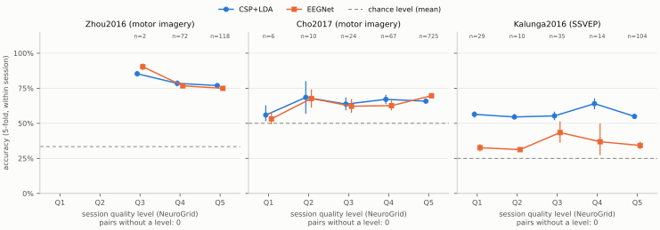
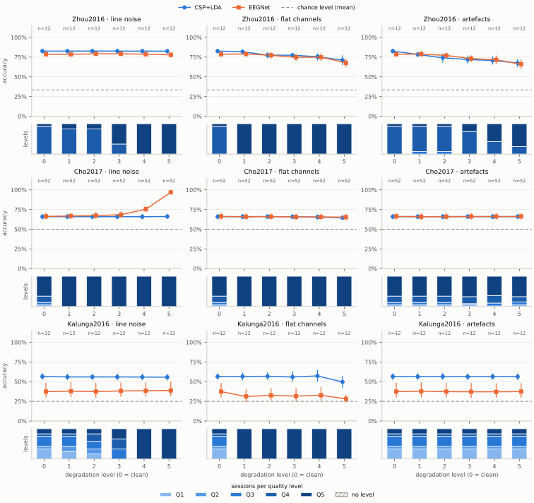

<!-- Generated by `python -m neuroarena.report render` from results/; do not edit by hand. -->

# NeuroArena: decoder accuracy over the NeuroGrid quality level

Technical report of NeuroArena 0.1.0 (NG-F17): reported run `full-1`, its repetition `full-2`, mode `full`. Every number below comes from the published files in `results/`.

## Goal

How does the accuracy of two standard decoders change with the NeuroGrid quality level of the data they are trained and tested on? NeuroArena checks every recording of 3 public MOABB datasets with NeuroGrid, gives every session a quality level Q1–Q5, degrades the data in a controlled way in 5 levels per kind (line noise, flat channels, artefacts) and evaluates CSP+LDA and EEGNet in every session under every condition (PRD section 16, NG-F17). The main result is the curve of the accuracy over the measured quality level (F5f A); the accuracy over the degradation level is the second view (F5f B).

## Data

The run used 3 public MOABB datasets as the loaders of moabb 1.7.2 return them (the loader's numbers count, not the documentation), with all subjects of every dataset (F2 A). Sessions, recordings and trials per session of every dataset:

| Dataset | Paradigm | Classes | Subjects | Sessions | Recordings | EEG channels | Sampling rate | Line frequency | Trials per session |
|---|---|---|---|---|---|---|---|---|---|
| Zhou2016 | motor imagery | left_hand, right_hand, feet | 4 | 12 | 24 | 14 | 250 Hz | 50 Hz | 135–179 |
| Cho2017 | motor imagery | left_hand, right_hand | 52 | 52 | 52 | 64 | 512 Hz | 60 Hz | 200–240 |
| Kalunga2016 | SSVEP | 13, 17, 21, rest | 12 | 12 | 30 | 8 | 256 Hz | 50 Hz | 64–160 |

### Attribution

**Zhou2016**

- Citation: Zhou B, Wu X, Lv Z, Zhang L, Guo X (2016) A Fully Automated Trial Selection Method for Optimization of Motor Imagery Based Brain-Computer Interface. PLoS ONE 11(9). https://doi.org/10.1371/journal.pone.0162657
- Paper: [doi:10.1371/journal.pone.0162657](https://doi.org/10.1371/journal.pone.0162657)
- Source of the data: doi:10.6084/m9.figshare.2061654
- Downloaded from: https://zenodo.org/api/records/16534752
- Licence at the download source: CC-BY-4.0. CC-BY-4.0 at the download source of moabb 1.7.2, the BIDS conversion by MOABB in Zenodo record 16534752 (Zenodo API, checked 2026-11-02; 8 files, 0.126 GB). The original figshare item doi:10.6084/m9.figshare.2061654 is CC0-1.0 (figshare API).

**Cho2017**

- Citation: Cho, H., Ahn, M., Ahn, S., Kwon, M. and Jun, S.C., 2017. EEG datasets for motor imagery brain computer interface. GigaScience. https://doi.org/10.1093/gigascience/gix034
- Paper: [doi:10.1093/gigascience/gix034](https://doi.org/10.1093/gigascience/gix034)
- Source of the data: doi:10.5524/100295
- Downloaded from: https://s3.ap-northeast-1.wasabisys.com/gigadb-datasets/live/pub/10.5524/100001_101000/100295/mat_data/
- Licence at the download source: CC0-1.0. CC0-1.0 at GigaDB doi:10.5524/100295 (DataCite rightsIdentifier cc0-1.0, checked 2026-11-02; 9.97 GB per DataCite, about 0.2 GB per subject file). MOABB's own metadata says CC-BY-4.0, which is not what the source states.

**Kalunga2016**

- Citation: Emmanuel K. Kalunga, Sylvain Chevallier, Quentin Barthelemy. "Online SSVEP-based BCI using Riemannian Geometry". Neurocomputing, 2016. arXiv report: https://arxiv.org/abs/1501.03227
- Paper: [doi:10.1016/j.neucom.2016.01.007](https://doi.org/10.1016/j.neucom.2016.01.007)
- Source of the data: https://zenodo.org/record/2392979
- Downloaded from: https://zenodo.org/record/2392979/files/
- Licence at the download source: CC-BY-4.0. CC-BY-4.0 at Zenodo record 2392979 (Zenodo API, checked 2026-11-02; 36 FIF files, 0.110 GB).

The data were degraded in memory; NeuroGrid read them as temporary FIF files that were deleted after each condition. NeuroArena does not redistribute the data: this repository holds code, aggregated results, figures and this report, no recording.

## Method

### NeuroGrid and the quality level (A-101, A-102)

neurogrid 1.0.0.dev0 checked the recordings of every dataset and condition once, through the public command line of the main project (A-101); NeuroArena never imports NeuroGrid. The call, with the run's own folders in place of the placeholders:

```
uv run --project <repo> --locked neurogrid check <folder> --config <toml> --show-paths --jobs N --out <file>
```

The degraded recordings were written as temporary FIF files (MNE format `single`). The core rule pack ran unchanged with its default thresholds and its sample (10 segments of 60 s, seed 20261011; at least 60 s of data for M06 and M09); findings of other rules are not used. The research configuration sets only these values per dataset (F5d):

| Dataset | `[quality] min_channels` | `[metadata.defaults] line_frequency_hz` |
|---|---|---|
| Zhou2016 | 14 | 50 |
| Cho2017 | 64 | 60 |
| Kalunga2016 | 8 | 50 |

For every recording, r = value / effective threshold for each rule below, read from NeuroGrid's results.json; M07 and M08 per recording are the maximum over the channels with a finite value. A rule that is not measurable is left out and counted; CORE-M07-02 (plausibility of the line frequency) does not count. The largest ratio gives the level (A-102): Q1: r < 0.5; Q2: 0.5 ≤ r < 0.75; Q3: 0.75 ≤ r < 1; Q4: 1 ≤ r < 1.5; Q5: r ≥ 1.5. A ratio at a boundary belongs to the higher level, so Q4 starts at the threshold and Q1–Q3 mean below every threshold. A recording without any measurable rule has no level; it is reported, never dropped. The level of a session is the worst level of its runs that have one.

| Rule | Value per recording | Effective threshold |
|---|---|---|
| `CORE-M06-01` | M06: share of bad EEG channels (pyprep) on NeuroGrid's sample | 0.30625 |
| `CORE-M07-01` | M07: line-noise ratio, maximum over the channels | 0.407669 |
| `CORE-M08-01` | M08: flat share of the duration, maximum over the channels | 0.05 |
| `CORE-M08-02` | M08: clipped share of the duration, maximum over the channels | 0.05 |
| `CORE-M09-01` | M09a: share of the epochs of the sample that local autoreject rejects | 0.305083 |
| `CORE-M09-02` | M09b: share of ICA components whose most likely ICLabel class is not brain | 0.6 |

### Degradation (A-103, F4)

16 conditions: the clean data and one ladder per kind with the levels 1–5 (F4a A). The degradation acts on the raw signal (MNE Raw, volts) before filtering and epoching, on the EEG channels only, with a seed per recording, kind and level (SHA-256 of their names); montage, channel set, annotations and events stay. The level values were fixed before the first run and never adapted to results (F4c).

- **Line noise:** a sinusoid at the dataset's line frequency plus its first harmonic at 0.5 of its amplitude (below the Nyquist frequency), with a random phase per channel; its power relative to the channel's power in 1–40 Hz is -15, -10, -5, 0, +10 dB for the levels 1–5.
- **Flat channels:** k EEG channels of a recording are set to 0 V, k = max(m, round(f · n)) with n the number of EEG channels, f = 5%, 10%, 20%, 35%, 50% and m = 1, 2, 3, 4, 5: Zhou2016: 1, 2, 3, 5, 7; Cho2017: 3, 6, 13, 22, 32; Kalunga2016: 1, 2, 3, 4, 5.
- **Artefacts:** 5%, 10%, 20%, 35%, 50% of the non-overlapping 2 s epochs of a recording receive one additive artefact each, the types in equal parts: eye blinks (Hann pulse of 0.4 s, 100–200 µV at the frontal pole, falling off towards the back of the head), muscle bursts (1 s, 20 Hz up to 5 Hz below the Nyquist frequency, RMS 20–50 µV at the most affected channel) and electrode pops (a step of 100–300 µV on 1 channel, decaying with a time constant of 0.3 s).

### Decoders (A-105, F7)

- **CSP+LDA** as the MOABB pipeline “CSP + LDA”: covariance estimator `oas`, CSP with 6 filters (log-variance), LDA (solver `svd`). Motor imagery: band-pass 8–32 Hz. SSVEP: a filter bank with one band of ±0.5 Hz around every stimulus frequency, CSP per band and LDA on the features of all bands; this is NeuroArena's own construction from the same blocks and not a typical SSVEP decoder (F7).
- **EEGNet:** `braindecode.models.EEGNet` with its default architecture as a skorch classifier, band-pass 4–40 Hz and resampling to 128 Hz; optimiser `torch.optim.Adam`, learning rate 0.001, batch size 16, loss `torch.nn.CrossEntropyLoss`, at most 300 epochs (300 in this run), early stopping on `valid_loss` with patience 50 on a stratified, seeded validation split of 20% of the training trials, keeping the weights of the best epoch; device `cpu`. No tuning on test data.
- **Deviation from the reference example (input scale):** the training follows the EEGNet authors' reference example (arl-eegmodels, `examples/ERP.py`), which scales the input from volts to millivolts. With braindecode's batch normalisation, millivolt input made early stopping end the training before EEGNet had learned (measured before the full run), so NeuroArena multiplies the input by 10^6 (volts to microvolts). The factor is a constant and is never fitted to the data.

### Evaluation (A-104, F6 A)

Training and test in the same condition: NeuroGrid checks training data, so the question is which accuracy data of a given quality level allow. 5-fold stratified cross-validation within every session (shuffled, seeded), as MOABB's within-session standard. The accuracy of a session is the number of correct test predictions over the number of test trials of all folds; its chance level is the share of its most frequent class. A point of a curve is the mean accuracy of the (session, condition) pairs in it with a 95% percentile bootstrap interval of the mean (10000 resamples, seeded): the main curve groups the pairs of all conditions by the session's quality level, the second groups them by the degradation level per kind, with the clean pairs at 0. Paired design: the folds of a session and the initial weights of EEGNet use the seed `derive_seed(dataset, subject, session)`, the same in every condition and for both decoders, so a curve shows the change of the data, not of the split.

### Reproducibility (A-106)

Base seed 20261102; worker processes start with spawn and the environment `MKL_NUM_THREADS=1`, `NUMEXPR_NUM_THREADS=1`, `OMP_NUM_THREADS=1`, `OPENBLAS_NUM_THREADS=1`, `PYTHONHASHSEED=0`, `VECLIB_MAXIMUM_THREADS=1`; torch runs with deterministic algorithms and one thread, on the CPU only. Equality of two runs is promised only per machine and lock; the two runs of this report ran on Windows AMD64 with these locks (SHA-256): `research/neuroarena/uv.lock` `34835bf5b9155adcf7a700966fb5d168867dc4e01383a70319b739a11ab8cc83`, `uv.lock` `febbebaf723ce0eb1df935b372ad279b47e385a1f4c8ea4c5ff65fc8e92d3f2d`. Versions: braindecode 1.8.1, mne 1.13.2, moabb 1.7.2, neuroarena 0.1.0, numpy 2.5.4, pandas 3.1.0, pyriemann 0.12, python 3.12.15, scikit-learn 1.9.1, scipy 1.18.1, skorch 1.4.0, torch 2.15.0+cpu.

## Results

Per dataset: sessions, conditions, (session, condition) pairs per decoder, pairs without a quality level and the mean chance level of the sessions:

| Dataset | Sessions | Conditions | Pairs per decoder | Pairs without a level | Mean chance level |
|---|---|---|---|---|---|
| Zhou2016 | 12 | 16 | 192 | 0 | 33.4% |
| Cho2017 | 52 | 16 | 832 | 0 | 50.0% |
| Kalunga2016 | 12 | 16 | 192 | 0 | 25.0% |

### Accuracy over the quality level (main figure, F5f A)



Figure 1. Accuracy over the session's quality level per dataset and decoder: mean of the (session, condition) pairs at that level with its 95% bootstrap interval; dashed line: mean chance level of the dataset; n: pairs per level (CSP+LDA/EEGNet where they differ); below each panel the pairs without a level. A level without pairs has no point. Also as [PNG](../../results/accuracy_over_quality.png).

| Dataset | Decoder | Q1 | Q2 | Q3 | Q4 | Q5 | Without a level |
|---|---|---|---|---|---|---|---|
| Zhou2016 | CSP+LDA | – | – | 85.3% [83.3–87.3] (2) | 78.5% [76.3–80.6] (72) | 76.9% [75.3–78.4] (118) | 0 |
| Zhou2016 | EEGNet | – | – | 90.3% [88.0–92.7] (2) | 76.7% [75.2–78.2] (72) | 74.9% [73.3–76.5] (118) | 0 |
| Cho2017 | CSP+LDA | 55.9% [51.5–62.8] (6) | 68.5% [56.8–80.2] (10) | 63.7% [59.3–68.4] (24) | 67.1% [63.8–70.4] (67) | 65.8% [64.9–66.7] (725) | 0 |
| Cho2017 | EEGNet | 53.2% [49.4–58.0] (6) | 67.7% [61.2–74.2] (10) | 62.2% [57.5–67.3] (24) | 62.6% [59.2–66.2] (67) | 69.7% [68.5–70.9] (725) | 0 |
| Kalunga2016 | CSP+LDA | 56.4% [54.0–58.5] (29) | 54.5% [53.1–56.6] (10) | 55.3% [52.3–58.3] (35) | 64.0% [60.0–67.8] (14) | 54.9% [53.1–56.8] (104) | 0 |
| Kalunga2016 | EEGNet | 32.6% [29.9–35.2] (29) | 31.2% [31.0–31.5] (10) | 43.4% [36.1–51.4] (35) | 36.9% [27.2–49.9] (14) | 34.2% [31.6–37.0] (104) | 0 |

Cells: mean accuracy [bootstrap interval] (pairs); –: no pair at that level, never filled in.

### Accuracy over the degradation level (second figure, F5f B)



Figure 2. Accuracy over the degradation level per dataset (rows) and kind (columns), clean at 0; dashed line: mean chance level; n: pairs per level. Under each panel: the share of sessions per quality level at each degradation level. Also as [PNG](../../results/accuracy_over_degradation.png).

| Dataset | Decoder | Kind | 0 (clean) | 1 | 2 | 3 | 4 | 5 |
|---|---|---|---|---|---|---|---|---|
| Zhou2016 | CSP+LDA | line noise | 82.6% [79.6–85.5] (12) | 82.6% [79.5–85.5] (12) | 82.7% [79.7–85.6] (12) | 82.6% [79.6–85.5] (12) | 82.6% [79.5–85.5] (12) | 82.5% [79.5–85.5] (12) |
| Zhou2016 | CSP+LDA | flat channels | 82.6% [79.6–85.5] (12) | 81.9% [79.1–84.7] (12) | 77.5% [73.6–81.1] (12) | 77.4% [74.5–80.3] (12) | 75.5% [70.8–79.7] (12) | 71.1% [64.7–77.3] (12) |
| Zhou2016 | CSP+LDA | artefacts | 82.6% [79.5–85.5] (12) | 78.3% [75.1–81.2] (12) | 74.1% [68.0–79.3] (12) | 71.9% [66.8–77.0] (12) | 70.7% [65.6–75.8] (12) | 67.4% [62.0–72.6] (12) |
| Zhou2016 | EEGNet | line noise | 78.7% [76.0–81.7] (12) | 78.6% [75.8–81.5] (12) | 79.2% [76.6–82.0] (12) | 79.2% [76.2–82.2] (12) | 78.7% [75.8–81.6] (12) | 77.9% [74.6–81.3] (12) |
| Zhou2016 | EEGNet | flat channels | 78.7% [75.9–81.7] (12) | 79.0% [75.7–82.3] (12) | 77.3% [73.4–81.2] (12) | 74.7% [70.4–79.0] (12) | 74.9% [69.9–79.9] (12) | 67.7% [62.0–72.9] (12) |
| Zhou2016 | EEGNet | artefacts | 78.7% [76.0–81.8] (12) | 78.9% [75.6–82.3] (12) | 77.1% [73.8–80.5] (12) | 73.1% [68.9–77.3] (12) | 71.6% [66.1–77.1] (12) | 65.9% [60.1–72.2] (12) |
| Cho2017 | CSP+LDA | line noise | 65.9% [62.5–69.3] (52) | 65.9% [62.6–69.4] (52) | 65.9% [62.5–69.4] (52) | 65.9% [62.5–69.4] (52) | 65.8% [62.4–69.3] (52) | 66.1% [62.8–69.5] (52) |
| Cho2017 | CSP+LDA | flat channels | 65.9% [62.5–69.4] (52) | 65.9% [62.6–69.3] (52) | 66.0% [62.8–69.3] (52) | 65.8% [62.5–69.2] (52) | 65.4% [62.3–68.9] (52) | 64.6% [61.5–67.8] (52) |
| Cho2017 | CSP+LDA | artefacts | 65.9% [62.5–69.5] (52) | 65.9% [62.5–69.4] (52) | 65.9% [62.5–69.3] (52) | 66.0% [62.6–69.4] (52) | 65.9% [62.5–69.3] (52) | 65.9% [62.5–69.4] (52) |
| Cho2017 | EEGNet | line noise | 66.2% [62.2–70.3] (52) | 66.8% [62.8–70.9] (52) | 67.3% [63.2–71.5] (52) | 68.4% [64.3–72.5] (52) | 75.4% [71.7–79.2] (52) | 96.8% [95.2–98.2] (52) |
| Cho2017 | EEGNet | flat channels | 66.2% [62.3–70.2] (52) | 65.9% [61.9–70.1] (52) | 66.0% [62.0–70.1] (52) | 65.6% [61.4–69.7] (52) | 65.6% [61.6–69.7] (52) | 65.3% [61.4–69.3] (52) |
| Cho2017 | EEGNet | artefacts | 66.2% [62.3–70.4] (52) | 65.9% [62.0–70.0] (52) | 66.0% [62.0–70.1] (52) | 66.1% [62.3–70.3] (52) | 66.2% [62.3–70.3] (52) | 66.2% [62.1–70.3] (52) |
| Kalunga2016 | CSP+LDA | line noise | 56.5% [52.1–60.9] (12) | 56.0% [51.8–60.1] (12) | 56.0% [51.8–60.3] (12) | 56.0% [51.8–60.0] (12) | 55.8% [51.8–60.1] (12) | 55.6% [51.6–59.6] (12) |
| Kalunga2016 | CSP+LDA | flat channels | 56.5% [52.2–60.7] (12) | 56.5% [51.8–61.5] (12) | 56.8% [52.1–62.0] (12) | 55.9% [50.0–62.8] (12) | 57.2% [50.0–64.9] (12) | 49.6% [41.8–57.1] (12) |
| Kalunga2016 | CSP+LDA | artefacts | 56.5% [52.1–60.8] (12) | 56.3% [52.1–60.7] (12) | 56.4% [52.1–60.8] (12) | 56.3% [51.8–60.7] (12) | 56.4% [52.4–60.6] (12) | 56.3% [52.1–60.4] (12) |
| Kalunga2016 | EEGNet | line noise | 37.4% [29.9–48.4] (12) | 37.9% [30.3–49.3] (12) | 37.3% [29.7–48.5] (12) | 38.2% [30.7–48.9] (12) | 38.4% [31.5–48.7] (12) | 38.8% [31.6–49.7] (12) |
| Kalunga2016 | EEGNet | flat channels | 37.4% [29.8–48.1] (12) | 31.1% [24.1–40.1] (12) | 32.6% [26.1–41.6] (12) | 31.6% [25.1–41.6] (12) | 32.8% [25.9–42.9] (12) | 28.1% [23.6–33.7] (12) |
| Kalunga2016 | EEGNet | artefacts | 37.4% [29.8–48.6] (12) | 37.8% [30.0–49.0] (12) | 37.3% [29.6–48.5] (12) | 37.1% [29.3–48.2] (12) | 37.1% [29.4–47.9] (12) | 37.4% [29.6–48.3] (12) |

Cells: mean accuracy [bootstrap interval] (pairs); –: no pair at that level, never filled in.

### Quality levels of the recordings

Recordings per quality level in every condition, and the sessions per level (quality_summary.csv). Q4 or worse: at or above at least one threshold.

| Dataset | Condition | Recordings | Q1 | Q2 | Q3 | Q4 | Q5 | No level | Q4 or worse | Sessions Q1/Q2/Q3/Q4/Q5/none |
|---|---|---|---|---|---|---|---|---|---|---|
| Zhou2016 | clean | 24 | 0 | 3 | 0 | 20 | 1 | 0 | 87.5% | 0/0/0/11/1/0 |
| Zhou2016 | line noise 1 | 24 | 0 | 3 | 0 | 19 | 2 | 0 | 87.5% | 0/0/0/10/2/0 |
| Zhou2016 | line noise 2 | 24 | 0 | 2 | 1 | 19 | 2 | 0 | 87.5% | 0/0/0/10/2/0 |
| Zhou2016 | line noise 3 | 24 | 0 | 0 | 1 | 11 | 12 | 0 | 95.8% | 0/0/0/4/8/0 |
| Zhou2016 | line noise 4 | 24 | 0 | 0 | 0 | 0 | 24 | 0 | 100.0% | 0/0/0/0/12/0 |
| Zhou2016 | line noise 5 | 24 | 0 | 0 | 0 | 0 | 24 | 0 | 100.0% | 0/0/0/0/12/0 |
| Zhou2016 | flat channels 1 | 24 | 0 | 0 | 0 | 0 | 24 | 0 | 100.0% | 0/0/0/0/12/0 |
| Zhou2016 | flat channels 2 | 24 | 0 | 0 | 0 | 0 | 24 | 0 | 100.0% | 0/0/0/0/12/0 |
| Zhou2016 | flat channels 3 | 24 | 0 | 0 | 0 | 0 | 24 | 0 | 100.0% | 0/0/0/0/12/0 |
| Zhou2016 | flat channels 4 | 24 | 0 | 0 | 0 | 0 | 24 | 0 | 100.0% | 0/0/0/0/12/0 |
| Zhou2016 | flat channels 5 | 24 | 0 | 0 | 0 | 0 | 24 | 0 | 100.0% | 0/0/0/0/12/0 |
| Zhou2016 | artefacts 1 | 24 | 0 | 1 | 4 | 18 | 1 | 0 | 79.2% | 0/0/1/10/1/0 |
| Zhou2016 | artefacts 2 | 24 | 0 | 0 | 5 | 18 | 1 | 0 | 79.2% | 0/0/1/10/1/0 |
| Zhou2016 | artefacts 3 | 24 | 0 | 0 | 1 | 20 | 3 | 0 | 95.8% | 0/0/0/9/3/0 |
| Zhou2016 | artefacts 4 | 24 | 0 | 0 | 0 | 16 | 8 | 0 | 100.0% | 0/0/0/5/7/0 |
| Zhou2016 | artefacts 5 | 24 | 0 | 0 | 1 | 11 | 12 | 0 | 95.8% | 0/0/0/3/9/0 |
| Cho2017 | clean | 52 | 1 | 2 | 4 | 11 | 34 | 0 | 86.5% | 1/2/4/11/34/0 |
| Cho2017 | line noise 1 | 52 | 0 | 0 | 0 | 0 | 52 | 0 | 100.0% | 0/0/0/0/52/0 |
| Cho2017 | line noise 2 | 52 | 0 | 0 | 0 | 0 | 52 | 0 | 100.0% | 0/0/0/0/52/0 |
| Cho2017 | line noise 3 | 52 | 0 | 0 | 0 | 0 | 52 | 0 | 100.0% | 0/0/0/0/52/0 |
| Cho2017 | line noise 4 | 52 | 0 | 0 | 0 | 0 | 52 | 0 | 100.0% | 0/0/0/0/52/0 |
| Cho2017 | line noise 5 | 52 | 0 | 0 | 0 | 0 | 52 | 0 | 100.0% | 0/0/0/0/52/0 |
| Cho2017 | flat channels 1 | 52 | 0 | 0 | 0 | 0 | 52 | 0 | 100.0% | 0/0/0/0/52/0 |
| Cho2017 | flat channels 2 | 52 | 0 | 0 | 0 | 0 | 52 | 0 | 100.0% | 0/0/0/0/52/0 |
| Cho2017 | flat channels 3 | 52 | 0 | 0 | 0 | 0 | 52 | 0 | 100.0% | 0/0/0/0/52/0 |
| Cho2017 | flat channels 4 | 52 | 0 | 0 | 0 | 0 | 52 | 0 | 100.0% | 0/0/0/0/52/0 |
| Cho2017 | flat channels 5 | 52 | 0 | 0 | 0 | 0 | 52 | 0 | 100.0% | 0/0/0/0/52/0 |
| Cho2017 | artefacts 1 | 52 | 1 | 2 | 4 | 11 | 34 | 0 | 86.5% | 1/2/4/11/34/0 |
| Cho2017 | artefacts 2 | 52 | 1 | 2 | 4 | 11 | 34 | 0 | 86.5% | 1/2/4/11/34/0 |
| Cho2017 | artefacts 3 | 52 | 1 | 2 | 2 | 12 | 35 | 0 | 90.4% | 1/2/2/12/35/0 |
| Cho2017 | artefacts 4 | 52 | 1 | 0 | 5 | 13 | 33 | 0 | 88.5% | 1/0/5/13/33/0 |
| Cho2017 | artefacts 5 | 52 | 1 | 2 | 5 | 9 | 35 | 0 | 84.6% | 1/2/5/9/35/0 |
| Kalunga2016 | clean | 30 | 15 | 6 | 5 | 1 | 3 | 0 | 13.3% | 4/1/4/1/2/0 |
| Kalunga2016 | line noise 1 | 30 | 14 | 7 | 5 | 1 | 3 | 0 | 13.3% | 3/2/4/1/2/0 |
| Kalunga2016 | line noise 2 | 30 | 13 | 5 | 6 | 3 | 3 | 0 | 20.0% | 2/2/3/3/2/0 |
| Kalunga2016 | line noise 3 | 30 | 0 | 0 | 15 | 10 | 5 | 0 | 50.0% | 0/0/4/4/4/0 |
| Kalunga2016 | line noise 4 | 30 | 0 | 0 | 0 | 0 | 30 | 0 | 100.0% | 0/0/0/0/12/0 |
| Kalunga2016 | line noise 5 | 30 | 0 | 0 | 0 | 0 | 30 | 0 | 100.0% | 0/0/0/0/12/0 |
| Kalunga2016 | flat channels 1 | 30 | 0 | 0 | 0 | 0 | 30 | 0 | 100.0% | 0/0/0/0/12/0 |
| Kalunga2016 | flat channels 2 | 30 | 0 | 0 | 0 | 0 | 30 | 0 | 100.0% | 0/0/0/0/12/0 |
| Kalunga2016 | flat channels 3 | 30 | 0 | 0 | 0 | 0 | 30 | 0 | 100.0% | 0/0/0/0/12/0 |
| Kalunga2016 | flat channels 4 | 30 | 0 | 0 | 0 | 0 | 30 | 0 | 100.0% | 0/0/0/0/12/0 |
| Kalunga2016 | flat channels 5 | 30 | 0 | 0 | 0 | 0 | 30 | 0 | 100.0% | 0/0/0/0/12/0 |
| Kalunga2016 | artefacts 1 | 30 | 15 | 6 | 5 | 1 | 3 | 0 | 13.3% | 4/1/4/1/2/0 |
| Kalunga2016 | artefacts 2 | 30 | 15 | 6 | 5 | 1 | 3 | 0 | 13.3% | 4/1/4/1/2/0 |
| Kalunga2016 | artefacts 3 | 30 | 15 | 6 | 5 | 1 | 3 | 0 | 13.3% | 4/1/4/1/2/0 |
| Kalunga2016 | artefacts 4 | 30 | 15 | 6 | 5 | 1 | 3 | 0 | 13.3% | 4/1/4/1/2/0 |
| Kalunga2016 | artefacts 5 | 30 | 15 | 6 | 5 | 1 | 3 | 0 | 13.3% | 4/1/4/1/2/0 |

Clean recordings: how often each rule gave the level (worst rule), how often it was not measurable, and its median ratio over the recordings where it was measured:

| Dataset | Rule | Worst rule | Not measurable | Median ratio |
|---|---|---|---|---|
| Zhou2016 | M06 bad channels | 18 | 0 | 1.17 |
| Zhou2016 | M07 line noise | 0 | 0 | 0.00 |
| Zhou2016 | M08 flat | 1 | 0 | 0.00 |
| Zhou2016 | M08 clipping | 0 | 0 | 0.00 |
| Zhou2016 | M09a autoreject | 5 | 0 | 0.61 |
| Zhou2016 | M09b ICLabel | 0 | 24 | – |
| Cho2017 | M06 bad channels | 0 | 0 | 0.18 |
| Cho2017 | M07 line noise | 11 | 0 | 0.22 |
| Cho2017 | M08 flat | 0 | 0 | 0.00 |
| Cho2017 | M08 clipping | 0 | 0 | 0.01 |
| Cho2017 | M09a autoreject | 41 | 0 | 1.51 |
| Cho2017 | M09b ICLabel | 0 | 51 | 1.25 |
| Kalunga2016 | M06 bad channels | 7 | 0 | 0.00 |
| Kalunga2016 | M07 line noise | 4 | 0 | 0.08 |
| Kalunga2016 | M08 flat | 0 | 0 | 0.00 |
| Kalunga2016 | M08 clipping | 0 | 0 | 0.00 |
| Kalunga2016 | M09a autoreject | 3 | 0 | 0.07 |
| Kalunga2016 | M09b ICLabel | 16 | 9 | 0.48 |

Rules that were not measurable, with NeuroGrid's reason key, summed over all conditions (unmeasured.csv):

| Dataset | Rule | Reason | Recordings | Conditions |
|---|---|---|---|---|
| Zhou2016 | M09b ICLabel | `quality.too_few_channels` | 384 | 16 |
| Cho2017 | M09b ICLabel | `quality.too_few_channels` | 820 | 16 |
| Kalunga2016 | M09a autoreject | `quality.too_few_channels` | 5 | 1 |
| Kalunga2016 | M09b ICLabel | `quality.too_few_channels` | 249 | 16 |

### Comparison of the two runs (DoD 1)

`compare_runs` on the reported run `full-1` and its repetition `full-2`: **exactly equal**. Compared: 48 quality.json files, the NeuroGrid values of 1696 recordings and 12160 folds. EEGNet tolerance: none (every EEGNet fold exactly equal, as every CSP+LDA fold and every NeuroGrid value). Differences: 0.

## Limitations

- **Clean data at Q4 or worse (pilot finding, A-109).** Clean recordings at Q4 or worse: Zhou2016 21 of 24 (87.5%); Cho2017 45 of 52 (86.5%); Kalunga2016 4 of 30 (13.3%). The rule that gave the level of the clean recordings (worst rule): Zhou2016: M06 bad channels 18, M09a autoreject 5, M08 flat 1; Cho2017: M09a autoreject 41, M07 line noise 11; Kalunga2016: M09b ICLabel 16, M06 bad channels 7, M07 line noise 4, M09a autoreject 3. The pilot measured this before the full run; the owner decided to continue and to report it as a finding, with the datasets and NeuroGrid unchanged. NeuroGrid's calibrated thresholds (M06, M07, M09) are the 95th percentile of a public test corpus of other recordings and are not adapted to these datasets; where clean data lie at or above a threshold, the quality axis of that dataset has little range below Q4.
- **M09a can miss local artefacts.** M09a is the share of epochs that local autoreject rejects, and autoreject first interpolates a few bad channels of an epoch: an artefact on one or a few channels (an electrode pop, a frontal blink) is repaired rather than rejected. Median M09a ratio, clean and at the highest artefact level of the run: Zhou2016 0.61 → 1.56 (artefacts 5); Cho2017 1.51 → 1.62 (artefacts 5); Kalunga2016 0.07 → 0.07 (artefacts 5).
- **M09b is often not measurable with few EEG channels.** The research configuration sets `min_channels` to the number of EEG channels of the dataset, and M09b needs that many channels once the bad channels of M06 are left out, so one bad channel is enough to make it not measurable. Clean recordings without M09b: Zhou2016 (14 channels) 24 of 24, reasons: `quality.too_few_channels` 24; Cho2017 (64 channels) 51 of 52, reasons: `quality.too_few_channels` 51; Kalunga2016 (8 channels) 9 of 30, reasons: `quality.too_few_channels` 9.
- **The worst-ratio rule saturates (A-102, finding on A-45).** One flat channel gives M08 a flat share of the whole duration against a threshold of 0.05, a ratio of 20, so every level of the channel ladder lands at Q5 and the main curve mixes them there; the second figure separates them. Recordings at Q5 at the first level of the channel ladder: Zhou2016 24 of 24; Cho2017 52 of 52; Kalunga2016 30 of 30.
- **Band-pass filters remove most line noise before decoding.** CSP+LDA decodes motor imagery in 8–32 Hz and SSVEP in narrow bands around the stimulus frequencies, EEGNet uses 4–40 Hz, all below the line frequencies of the datasets (50, 60 Hz): the line-noise ladder can therefore move the quality level (M07) without moving the accuracy. Mean accuracy, clean and at the highest line-noise level of the run: Zhou2016 CSP+LDA 82.6% → 82.5% (line noise 5); Zhou2016 EEGNet 78.7% → 77.9% (line noise 5); Cho2017 CSP+LDA 65.9% → 66.1% (line noise 5); Cho2017 EEGNet 66.2% → 96.8% (line noise 5); Kalunga2016 CSP+LDA 56.5% → 55.6% (line noise 5); Kalunga2016 EEGNet 37.4% → 38.8% (line noise 5). For Cho2017 with EEGNet this does not hold; see the next item.
- **Cho2017: the added line noise carries the class (finding after the full runs, A-111).** MOABB's loader of Cho2017 puts the trials of each class into one block, with the trial onsets a whole number of periods of the line frequency apart, and joins the two blocks with a gap of zeros that is not a whole number of periods. The sinusoid of the line-noise ladder runs through the whole recording, so it has one phase at the onset of every trial of one class and another phase at the onset of every trial of the other class: the added noise is locked to the class. EEGNet's temporal convolutions respond to the phase and can learn such a signal from what the band-pass filter leaves of it; CSP+LDA uses the variance of the signal, which does not depend on the phase. Along the line-noise ladder of Cho2017 the EEGNet accuracy rises and the CSP+LDA accuracy does not. The EEGNet accuracies of this ladder, and the EEGNet point of Cho2017 at Q5 in the main figure, which contains its pairs, therefore cannot be read as decoding of EEG under line noise. The degradation was not changed after the results were seen (F4c). Mean accuracy of Cho2017 over the line-noise ladder (clean, levels 1–5): CSP+LDA: 65.9% → 65.9% → 65.9% → 65.9% → 65.8% → 66.1%; EEGNet: 66.2% → 66.8% → 67.3% → 68.4% → 75.4% → 96.8%. EEGNet at Q5 of Cho2017: 69.7% over 725 pairs, 260 of them from the line-noise ladder; without these 66.7% over 465 pairs (mean only, no interval).
- **Equality only per machine and lock (A-106).** Another machine, another BLAS build or another lock can give other EEGNet weights and so other accuracies; the comparison of the two runs holds for one machine and one lock, nothing is claimed across machines.
- **Cho2017: trials joined by MOABB.** The MOABB loader of Cho2017 joins the trials of a subject end to end into continuous runs, which leaves discontinuities at the joints. This is an unverified possible contributor to the M09a ratios of the clean Cho2017 recordings (median 1.51).
- **Few trials per Kalunga2016 session.** 64–160 trials per session, about 12.8 test trials per fold: one trial moves the accuracy of a session by up to 1.6 percentage points, and EEGNet trains on few examples.
- **Design limits.** CSP+LDA on SSVEP is not a typical SSVEP decoder (F7); EEGNet runs with default hyperparameters without tuning; training and test stay within one session and one condition (A-104). With few EEG channels (Zhou2016 14, Kalunga2016 8) M06 and M09 say less than on dense montages (F5d).

## Scope statement

This report applies only to the public datasets and decoders studied; no statement about the performance or safety of a medical device. NeuroGrid's quality level is used here as a research measure only (A-45); it is not part of NeuroGrid's own reports.

Report, figures and aggregated results: CC BY 4.0. The datasets keep their own licences (see Data).
