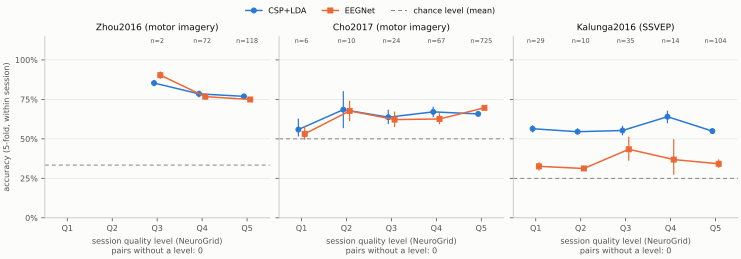
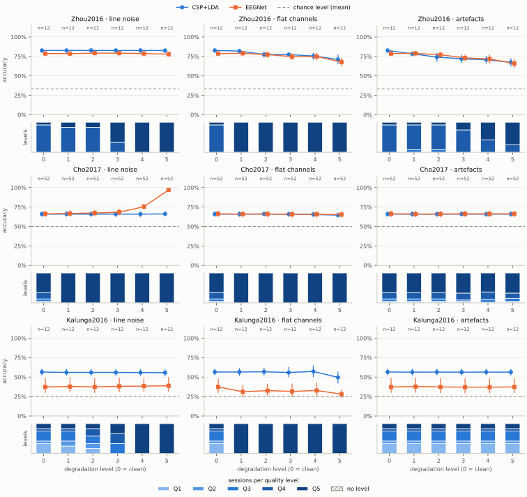

<!-- 由 `python -m neuroarena.report render` 根据 results/ 生成，请勿手工编辑。 -->

# NeuroArena：解码器准确率与 NeuroGrid 质量等级

NeuroArena 0.1.0 技术报告（NG-F17）：报告的运行为 `full-1`，其重复运行为 `full-2`，模式为 `full`。下文中的每个数字都来自 `results/` 中已发布的文件。

## 目标

训练和测试所用数据的 NeuroGrid 质量等级如何影响两种标准解码器的准确率？NeuroArena 用 NeuroGrid 检查 3 个公开 MOABB 数据集的每条记录，为每个会话确定 Q1–Q5 的质量等级，按类型（工频干扰、平直通道、伪迹）对数据进行每类 5 级的受控劣化，并在每种条件下于每个会话中评估 CSP+LDA 和 EEGNet（PRD 第 16 节，NG-F17）。主要结果是准确率随实测质量等级变化的曲线（F5f A）；准确率随劣化等级的变化是第二个视角（F5f B）。

## 数据

本次运行使用了 3 个公开 MOABB 数据集，数据以 moabb 1.7.2 加载器返回的形式为准（以加载器的数字为准，而非文档），采用每个数据集的全部受试者（F2 A）。各数据集的会话数、记录数和每个会话的试次数：

| 数据集 | 范式 | 类别 | 受试者 | 会话 | 记录 | EEG 通道 | 采样率 | 工频 | 每会话试次 |
|---|---|---|---|---|---|---|---|---|---|
| Zhou2016 | 运动想象 | left_hand、right_hand、feet | 4 | 12 | 24 | 14 | 250 Hz | 50 Hz | 135–179 |
| Cho2017 | 运动想象 | left_hand、right_hand | 52 | 52 | 52 | 64 | 512 Hz | 60 Hz | 200–240 |
| Kalunga2016 | SSVEP（稳态视觉诱发电位） | 13、17、21、rest | 12 | 12 | 30 | 8 | 256 Hz | 50 Hz | 64–160 |

### 数据来源与署名

**Zhou2016**

- 引用：Zhou B, Wu X, Lv Z, Zhang L, Guo X (2016) A Fully Automated Trial Selection Method for Optimization of Motor Imagery Based Brain-Computer Interface. PLoS ONE 11(9). https://doi.org/10.1371/journal.pone.0162657
- 论文：[doi:10.1371/journal.pone.0162657](https://doi.org/10.1371/journal.pone.0162657)
- 数据来源：doi:10.6084/m9.figshare.2061654
- 下载地址：https://zenodo.org/api/records/16534752
- 下载来源处的许可协议：CC-BY-4.0。说明（英文原文）：CC-BY-4.0 at the download source of moabb 1.7.2, the BIDS conversion by MOABB in Zenodo record 16534752 (Zenodo API, checked 2026-11-02; 8 files, 0.126 GB). The original figshare item doi:10.6084/m9.figshare.2061654 is CC0-1.0 (figshare API).

**Cho2017**

- 引用：Cho, H., Ahn, M., Ahn, S., Kwon, M. and Jun, S.C., 2017. EEG datasets for motor imagery brain computer interface. GigaScience. https://doi.org/10.1093/gigascience/gix034
- 论文：[doi:10.1093/gigascience/gix034](https://doi.org/10.1093/gigascience/gix034)
- 数据来源：doi:10.5524/100295
- 下载地址：https://s3.ap-northeast-1.wasabisys.com/gigadb-datasets/live/pub/10.5524/100001_101000/100295/mat_data/
- 下载来源处的许可协议：CC0-1.0。说明（英文原文）：CC0-1.0 at GigaDB doi:10.5524/100295 (DataCite rightsIdentifier cc0-1.0, checked 2026-11-02; 9.97 GB per DataCite, about 0.2 GB per subject file). MOABB's own metadata says CC-BY-4.0, which is not what the source states.

**Kalunga2016**

- 引用：Emmanuel K. Kalunga, Sylvain Chevallier, Quentin Barthelemy. "Online SSVEP-based BCI using Riemannian Geometry". Neurocomputing, 2016. arXiv report: https://arxiv.org/abs/1501.03227
- 论文：[doi:10.1016/j.neucom.2016.01.007](https://doi.org/10.1016/j.neucom.2016.01.007)
- 数据来源：https://zenodo.org/record/2392979
- 下载地址：https://zenodo.org/record/2392979/files/
- 下载来源处的许可协议：CC-BY-4.0。说明（英文原文）：CC-BY-4.0 at Zenodo record 2392979 (Zenodo API, checked 2026-11-02; 36 FIF files, 0.110 GB).

数据在内存中劣化；NeuroGrid 读取的是临时 FIF 文件，每种条件处理完毕后即被删除。NeuroArena 不对这些数据进行再分发：本代码库只包含代码、汇总结果、图和本报告，不包含任何记录。

## 方法

### NeuroGrid 与质量等级（A-101、A-102）

neurogrid 1.0.0.dev0 通过主项目的公开命令行，对每个数据集和每种条件的记录各检查一次（A-101）；NeuroArena 从不以库的方式导入 NeuroGrid。调用方式如下（占位符由本次运行自己的文件夹替代）：

```
uv run --project <repo> --locked neurogrid check <folder> --config <toml> --show-paths --jobs N --out <file>
```

劣化后的记录被写成临时 FIF 文件（MNE 格式 `single`）。core 规则包保持不变，使用其默认阈值和默认抽样（10 段，每段 60 秒，种子 20261011；M06 和 M09 至少需要 60 秒数据）；其他规则的结果不予使用。研究配置只为每个数据集设置以下两个值（F5d）：

| 数据集 | `[quality] min_channels` | `[metadata.defaults] line_frequency_hz` |
|---|---|---|
| Zhou2016 | 14 | 50 |
| Cho2017 | 64 | 60 |
| Kalunga2016 | 8 | 50 |

对每条记录，根据 NeuroGrid 的 results.json，计算下表中每条规则的 r = 测量值 / 有效阈值；M07 和 M08 在每条记录上取各通道有限值中的最大值。无法测量的规则被略去并计数；CORE-M07-02（工频合理性）不计入。比值最大的规则决定等级（A-102）：Q1: r < 0.5；Q2: 0.5 ≤ r < 0.75；Q3: 0.75 ≤ r < 1；Q4: 1 ≤ r < 1.5；Q5: r ≥ 1.5。比值恰好落在边界上时归入较高等级，因此 Q4 从阈值开始，Q1–Q3 表示低于所有阈值。没有任何可测规则的记录没有等级；这类记录会被列出，绝不丢弃。会话的等级是其各运行（run）中已有等级的最差等级。

| 规则 | 每条记录的测量值 | 有效阈值 |
|---|---|---|
| `CORE-M06-01` | M06：NeuroGrid 抽样数据中坏 EEG 通道的比例（pyprep） | 0.30625 |
| `CORE-M07-01` | M07：工频干扰比，取各通道最大值 | 0.407669 |
| `CORE-M08-01` | M08：平直段占时长的比例，取各通道最大值 | 0.05 |
| `CORE-M08-02` | M08：削波占时长的比例，取各通道最大值 | 0.05 |
| `CORE-M09-01` | M09a：抽样数据中被局部 autoreject 拒绝的分段比例 | 0.305083 |
| `CORE-M09-02` | M09b：最可能的 ICLabel 类别不是 brain 的 ICA 成分比例 | 0.6 |

### 受控劣化（A-103、F4）

共 16 种条件：干净数据，以及每种类型一条劣化阶梯，等级为 1–5（F4a A）。劣化作用于滤波和分段之前的原始信号（MNE Raw，单位伏特），只作用于 EEG 通道，每条记录、每种类型、每个等级使用各自的种子（由其名称的 SHA-256 得出）；电极布局、通道集合、标注和事件保持不变。各等级的取值在首次运行前已经确定，从未根据结果调整（F4c）。

- **工频干扰：** 在数据集的工频处叠加一个正弦波，并在其二次谐波处（低于奈奎斯特频率时）叠加振幅为基波 0.5 倍的正弦波，每个通道的相位随机；相对于该通道 1–40 Hz 频段功率，其功率在等级 1–5 依次为 -15、-10、-5、0、+10 dB。
- **平直通道：** 将一条记录中 k 个 EEG 通道置为 0 V，k = max(m, round(f · n))，其中 n 为 EEG 通道数，f = 5%、10%、20%、35%、50%，m = 1、2、3、4、5：Zhou2016：1、2、3、5、7；Cho2017：3、6、13、22、32；Kalunga2016：1、2、3、4、5。
- **伪迹：** 将一条记录划分为互不重叠的 2 秒分段，其中 5%、10%、20%、35%、50% 的分段各叠加一个伪迹，三种类型各占一份：眨眼（0.4 秒的 Hann 脉冲，额极处 100–200 µV，向头后部衰减）、肌电爆发（1 秒，20 Hz 至奈奎斯特频率以下 5 Hz，受影响最大的通道上均方根值为 20–50 µV）和电极跳变（1 个通道上 100–300 µV 的阶跃，按 0.3 秒的时间常数衰减）。

### 解码器（A-105、F7）

- **CSP+LDA**，与 MOABB 流水线“CSP + LDA”相同：协方差估计 `oas`，6 个滤波器的 CSP（对数方差），LDA（求解器 `svd`）。运动想象：8–32 Hz 带通滤波。SSVEP：滤波器组，在每个刺激频率周围取 ±0.5 Hz 的频带，每个频带各做 CSP，再用 LDA 处理所有频带的特征；这是 NeuroArena 用相同组件自行搭建的方案，并非典型的 SSVEP 解码器（F7）。
- **EEGNet：** 采用默认结构的 `braindecode.models.EEGNet`，作为 skorch 分类器；4–40 Hz 带通滤波并重采样至 128 Hz；优化器 `torch.optim.Adam`，学习率 0.001，批大小 16，损失函数 `torch.nn.CrossEntropyLoss`，最多 300 轮（本次运行的上限为 300 轮），在训练试次中按分层且固定种子的方式划出 20% 作为验证集，以 `valid_loss` 早停，耐心值 50，保留最佳一轮的权重；设备 `cpu`。不在测试数据上调参。
- **与参考示例的偏差（输入缩放）：** 训练过程遵循 EEGNet 作者的参考示例（arl-eegmodels，`examples/ERP.py`），该示例把输入从伏特换算为毫伏。在 braindecode 的批归一化下，毫伏输入使早停在 EEGNet 学到东西之前就结束了训练（完整运行前测得），因此 NeuroArena 将输入乘以 10^6（伏特换算为微伏）。该系数是常数，从不根据数据拟合。

### 评估（A-104、F6 A）

训练和测试在同一条件下进行：NeuroGrid 检查的是训练数据，因此问题在于某一质量等级的数据能支持多高的准确率。在每个会话内进行 5 折分层交叉验证（打乱，固定种子），与 MOABB 的会话内评估标准一致。会话的准确率为各折中预测正确的测试试次数之和除以测试试次总数；其随机水平为该会话中最常见类别所占的比例。曲线上的每个点是其中各（会话，条件）组合的平均准确率，并给出均值的 95% 自助法区间（百分位法，10000 次重抽样，固定种子）：主曲线按会话的质量等级对所有条件下的组合进行分组，第二张图按每种类型的劣化等级分组，干净数据位于 0。配对设计：一个会话的折划分和 EEGNet 的初始权重使用种子 `derive_seed(dataset, subject, session)`，在每种条件下、对两种解码器都相同，因此曲线反映的是数据的变化，而不是划分的变化。

### 可复现性（A-106）

基础种子 20261102；工作进程以 spawn 方式启动，环境变量为 `MKL_NUM_THREADS=1`、`NUMEXPR_NUM_THREADS=1`、`OMP_NUM_THREADS=1`、`OPENBLAS_NUM_THREADS=1`、`PYTHONHASHSEED=0`、`VECLIB_MAXIMUM_THREADS=1`；torch 使用确定性算法和单线程，只在 CPU 上运行。两次运行结果相同的保证只限于同一台机器和同一组锁文件；本报告的两次运行在 Windows AMD64 上完成，所用锁文件（SHA-256）为：`research/neuroarena/uv.lock` `34835bf5b9155adcf7a700966fb5d168867dc4e01383a70319b739a11ab8cc83`、`uv.lock` `febbebaf723ce0eb1df935b372ad279b47e385a1f4c8ea4c5ff65fc8e92d3f2d`。版本：braindecode 1.8.1、mne 1.13.2、moabb 1.7.2、neuroarena 0.1.0、numpy 2.5.4、pandas 3.1.0、pyriemann 0.12、python 3.12.15、scikit-learn 1.9.1、scipy 1.18.1、skorch 1.4.0、torch 2.15.0+cpu。

## 结果

各数据集的会话数、条件数、每种解码器的（会话，条件）组合数、没有质量等级的组合数，以及各会话随机水平的平均值：

| 数据集 | 会话 | 条件 | 每种解码器的组合数 | 无等级的组合数 | 平均随机水平 |
|---|---|---|---|---|---|
| Zhou2016 | 12 | 16 | 192 | 0 | 33.4% |
| Cho2017 | 52 | 16 | 832 | 0 | 50.0% |
| Kalunga2016 | 12 | 16 | 192 | 0 | 25.0% |

### 准确率随质量等级的变化（主图，F5f A）



图 1. 各数据集、各解码器的准确率随会话质量等级的变化：该等级下各（会话，条件）组合的平均值及其 95% 自助法区间；虚线：该数据集的平均随机水平；n：每个等级的组合数（两种解码器的组合数不同时，写作 CSP+LDA/EEGNet）；每个子图下方注明没有等级的组合数。没有组合的等级不画点。图中文字为英文。另有 [PNG 版本](../../results/accuracy_over_quality.png)。

| 数据集 | 解码器 | Q1 | Q2 | Q3 | Q4 | Q5 | 无等级 |
|---|---|---|---|---|---|---|---|
| Zhou2016 | CSP+LDA | – | – | 85.3% [83.3–87.3] (2) | 78.5% [76.3–80.6] (72) | 76.9% [75.3–78.4] (118) | 0 |
| Zhou2016 | EEGNet | – | – | 90.3% [88.0–92.7] (2) | 76.7% [75.2–78.2] (72) | 74.9% [73.3–76.5] (118) | 0 |
| Cho2017 | CSP+LDA | 55.9% [51.5–62.8] (6) | 68.5% [56.8–80.2] (10) | 63.7% [59.3–68.4] (24) | 67.1% [63.8–70.4] (67) | 65.8% [64.9–66.7] (725) | 0 |
| Cho2017 | EEGNet | 53.2% [49.4–58.0] (6) | 67.7% [61.2–74.2] (10) | 62.2% [57.5–67.3] (24) | 62.6% [59.2–66.2] (67) | 69.7% [68.5–70.9] (725) | 0 |
| Kalunga2016 | CSP+LDA | 56.4% [54.0–58.5] (29) | 54.5% [53.1–56.6] (10) | 55.3% [52.3–58.3] (35) | 64.0% [60.0–67.8] (14) | 54.9% [53.1–56.8] (104) | 0 |
| Kalunga2016 | EEGNet | 32.6% [29.9–35.2] (29) | 31.2% [31.0–31.5] (10) | 43.4% [36.1–51.4] (35) | 36.9% [27.2–49.9] (14) | 34.2% [31.6–37.0] (104) | 0 |

单元格：平均准确率 [自助法区间]（组合数）；–：该等级没有组合，不作填补。

### 准确率随劣化等级的变化（第二张图，F5f B）



图 2. 各数据集（行）、各劣化类型（列）的准确率随劣化等级的变化，干净数据位于 0；虚线：平均随机水平；n：每个等级的组合数。每个子图下方：各劣化等级下会话在各质量等级中所占的比例。图中文字为英文。另有 [PNG 版本](../../results/accuracy_over_degradation.png)。

| 数据集 | 解码器 | 类型 | 0（干净） | 1 | 2 | 3 | 4 | 5 |
|---|---|---|---|---|---|---|---|---|
| Zhou2016 | CSP+LDA | 工频干扰 | 82.6% [79.6–85.5] (12) | 82.6% [79.5–85.5] (12) | 82.7% [79.7–85.6] (12) | 82.6% [79.6–85.5] (12) | 82.6% [79.5–85.5] (12) | 82.5% [79.5–85.5] (12) |
| Zhou2016 | CSP+LDA | 平直通道 | 82.6% [79.6–85.5] (12) | 81.9% [79.1–84.7] (12) | 77.5% [73.6–81.1] (12) | 77.4% [74.5–80.3] (12) | 75.5% [70.8–79.7] (12) | 71.1% [64.7–77.3] (12) |
| Zhou2016 | CSP+LDA | 伪迹 | 82.6% [79.5–85.5] (12) | 78.3% [75.1–81.2] (12) | 74.1% [68.0–79.3] (12) | 71.9% [66.8–77.0] (12) | 70.7% [65.6–75.8] (12) | 67.4% [62.0–72.6] (12) |
| Zhou2016 | EEGNet | 工频干扰 | 78.7% [76.0–81.7] (12) | 78.6% [75.8–81.5] (12) | 79.2% [76.6–82.0] (12) | 79.2% [76.2–82.2] (12) | 78.7% [75.8–81.6] (12) | 77.9% [74.6–81.3] (12) |
| Zhou2016 | EEGNet | 平直通道 | 78.7% [75.9–81.7] (12) | 79.0% [75.7–82.3] (12) | 77.3% [73.4–81.2] (12) | 74.7% [70.4–79.0] (12) | 74.9% [69.9–79.9] (12) | 67.7% [62.0–72.9] (12) |
| Zhou2016 | EEGNet | 伪迹 | 78.7% [76.0–81.8] (12) | 78.9% [75.6–82.3] (12) | 77.1% [73.8–80.5] (12) | 73.1% [68.9–77.3] (12) | 71.6% [66.1–77.1] (12) | 65.9% [60.1–72.2] (12) |
| Cho2017 | CSP+LDA | 工频干扰 | 65.9% [62.5–69.3] (52) | 65.9% [62.6–69.4] (52) | 65.9% [62.5–69.4] (52) | 65.9% [62.5–69.4] (52) | 65.8% [62.4–69.3] (52) | 66.1% [62.8–69.5] (52) |
| Cho2017 | CSP+LDA | 平直通道 | 65.9% [62.5–69.4] (52) | 65.9% [62.6–69.3] (52) | 66.0% [62.8–69.3] (52) | 65.8% [62.5–69.2] (52) | 65.4% [62.3–68.9] (52) | 64.6% [61.5–67.8] (52) |
| Cho2017 | CSP+LDA | 伪迹 | 65.9% [62.5–69.5] (52) | 65.9% [62.5–69.4] (52) | 65.9% [62.5–69.3] (52) | 66.0% [62.6–69.4] (52) | 65.9% [62.5–69.3] (52) | 65.9% [62.5–69.4] (52) |
| Cho2017 | EEGNet | 工频干扰 | 66.2% [62.2–70.3] (52) | 66.8% [62.8–70.9] (52) | 67.3% [63.2–71.5] (52) | 68.4% [64.3–72.5] (52) | 75.4% [71.7–79.2] (52) | 96.8% [95.2–98.2] (52) |
| Cho2017 | EEGNet | 平直通道 | 66.2% [62.3–70.2] (52) | 65.9% [61.9–70.1] (52) | 66.0% [62.0–70.1] (52) | 65.6% [61.4–69.7] (52) | 65.6% [61.6–69.7] (52) | 65.3% [61.4–69.3] (52) |
| Cho2017 | EEGNet | 伪迹 | 66.2% [62.3–70.4] (52) | 65.9% [62.0–70.0] (52) | 66.0% [62.0–70.1] (52) | 66.1% [62.3–70.3] (52) | 66.2% [62.3–70.3] (52) | 66.2% [62.1–70.3] (52) |
| Kalunga2016 | CSP+LDA | 工频干扰 | 56.5% [52.1–60.9] (12) | 56.0% [51.8–60.1] (12) | 56.0% [51.8–60.3] (12) | 56.0% [51.8–60.0] (12) | 55.8% [51.8–60.1] (12) | 55.6% [51.6–59.6] (12) |
| Kalunga2016 | CSP+LDA | 平直通道 | 56.5% [52.2–60.7] (12) | 56.5% [51.8–61.5] (12) | 56.8% [52.1–62.0] (12) | 55.9% [50.0–62.8] (12) | 57.2% [50.0–64.9] (12) | 49.6% [41.8–57.1] (12) |
| Kalunga2016 | CSP+LDA | 伪迹 | 56.5% [52.1–60.8] (12) | 56.3% [52.1–60.7] (12) | 56.4% [52.1–60.8] (12) | 56.3% [51.8–60.7] (12) | 56.4% [52.4–60.6] (12) | 56.3% [52.1–60.4] (12) |
| Kalunga2016 | EEGNet | 工频干扰 | 37.4% [29.9–48.4] (12) | 37.9% [30.3–49.3] (12) | 37.3% [29.7–48.5] (12) | 38.2% [30.7–48.9] (12) | 38.4% [31.5–48.7] (12) | 38.8% [31.6–49.7] (12) |
| Kalunga2016 | EEGNet | 平直通道 | 37.4% [29.8–48.1] (12) | 31.1% [24.1–40.1] (12) | 32.6% [26.1–41.6] (12) | 31.6% [25.1–41.6] (12) | 32.8% [25.9–42.9] (12) | 28.1% [23.6–33.7] (12) |
| Kalunga2016 | EEGNet | 伪迹 | 37.4% [29.8–48.6] (12) | 37.8% [30.0–49.0] (12) | 37.3% [29.6–48.5] (12) | 37.1% [29.3–48.2] (12) | 37.1% [29.4–47.9] (12) | 37.4% [29.6–48.3] (12) |

单元格：平均准确率 [自助法区间]（组合数）；–：该等级没有组合，不作填补。

### 记录的质量等级

每种条件下各质量等级的记录数，以及各等级的会话数（quality_summary.csv）。Q4 及更差：至少达到或超过一个阈值。

| 数据集 | 条件 | 记录 | Q1 | Q2 | Q3 | Q4 | Q5 | 无等级 | Q4 及更差 | 会话 Q1/Q2/Q3/Q4/Q5/无 |
|---|---|---|---|---|---|---|---|---|---|---|
| Zhou2016 | 干净 | 24 | 0 | 3 | 0 | 20 | 1 | 0 | 87.5% | 0/0/0/11/1/0 |
| Zhou2016 | 工频干扰 1 | 24 | 0 | 3 | 0 | 19 | 2 | 0 | 87.5% | 0/0/0/10/2/0 |
| Zhou2016 | 工频干扰 2 | 24 | 0 | 2 | 1 | 19 | 2 | 0 | 87.5% | 0/0/0/10/2/0 |
| Zhou2016 | 工频干扰 3 | 24 | 0 | 0 | 1 | 11 | 12 | 0 | 95.8% | 0/0/0/4/8/0 |
| Zhou2016 | 工频干扰 4 | 24 | 0 | 0 | 0 | 0 | 24 | 0 | 100.0% | 0/0/0/0/12/0 |
| Zhou2016 | 工频干扰 5 | 24 | 0 | 0 | 0 | 0 | 24 | 0 | 100.0% | 0/0/0/0/12/0 |
| Zhou2016 | 平直通道 1 | 24 | 0 | 0 | 0 | 0 | 24 | 0 | 100.0% | 0/0/0/0/12/0 |
| Zhou2016 | 平直通道 2 | 24 | 0 | 0 | 0 | 0 | 24 | 0 | 100.0% | 0/0/0/0/12/0 |
| Zhou2016 | 平直通道 3 | 24 | 0 | 0 | 0 | 0 | 24 | 0 | 100.0% | 0/0/0/0/12/0 |
| Zhou2016 | 平直通道 4 | 24 | 0 | 0 | 0 | 0 | 24 | 0 | 100.0% | 0/0/0/0/12/0 |
| Zhou2016 | 平直通道 5 | 24 | 0 | 0 | 0 | 0 | 24 | 0 | 100.0% | 0/0/0/0/12/0 |
| Zhou2016 | 伪迹 1 | 24 | 0 | 1 | 4 | 18 | 1 | 0 | 79.2% | 0/0/1/10/1/0 |
| Zhou2016 | 伪迹 2 | 24 | 0 | 0 | 5 | 18 | 1 | 0 | 79.2% | 0/0/1/10/1/0 |
| Zhou2016 | 伪迹 3 | 24 | 0 | 0 | 1 | 20 | 3 | 0 | 95.8% | 0/0/0/9/3/0 |
| Zhou2016 | 伪迹 4 | 24 | 0 | 0 | 0 | 16 | 8 | 0 | 100.0% | 0/0/0/5/7/0 |
| Zhou2016 | 伪迹 5 | 24 | 0 | 0 | 1 | 11 | 12 | 0 | 95.8% | 0/0/0/3/9/0 |
| Cho2017 | 干净 | 52 | 1 | 2 | 4 | 11 | 34 | 0 | 86.5% | 1/2/4/11/34/0 |
| Cho2017 | 工频干扰 1 | 52 | 0 | 0 | 0 | 0 | 52 | 0 | 100.0% | 0/0/0/0/52/0 |
| Cho2017 | 工频干扰 2 | 52 | 0 | 0 | 0 | 0 | 52 | 0 | 100.0% | 0/0/0/0/52/0 |
| Cho2017 | 工频干扰 3 | 52 | 0 | 0 | 0 | 0 | 52 | 0 | 100.0% | 0/0/0/0/52/0 |
| Cho2017 | 工频干扰 4 | 52 | 0 | 0 | 0 | 0 | 52 | 0 | 100.0% | 0/0/0/0/52/0 |
| Cho2017 | 工频干扰 5 | 52 | 0 | 0 | 0 | 0 | 52 | 0 | 100.0% | 0/0/0/0/52/0 |
| Cho2017 | 平直通道 1 | 52 | 0 | 0 | 0 | 0 | 52 | 0 | 100.0% | 0/0/0/0/52/0 |
| Cho2017 | 平直通道 2 | 52 | 0 | 0 | 0 | 0 | 52 | 0 | 100.0% | 0/0/0/0/52/0 |
| Cho2017 | 平直通道 3 | 52 | 0 | 0 | 0 | 0 | 52 | 0 | 100.0% | 0/0/0/0/52/0 |
| Cho2017 | 平直通道 4 | 52 | 0 | 0 | 0 | 0 | 52 | 0 | 100.0% | 0/0/0/0/52/0 |
| Cho2017 | 平直通道 5 | 52 | 0 | 0 | 0 | 0 | 52 | 0 | 100.0% | 0/0/0/0/52/0 |
| Cho2017 | 伪迹 1 | 52 | 1 | 2 | 4 | 11 | 34 | 0 | 86.5% | 1/2/4/11/34/0 |
| Cho2017 | 伪迹 2 | 52 | 1 | 2 | 4 | 11 | 34 | 0 | 86.5% | 1/2/4/11/34/0 |
| Cho2017 | 伪迹 3 | 52 | 1 | 2 | 2 | 12 | 35 | 0 | 90.4% | 1/2/2/12/35/0 |
| Cho2017 | 伪迹 4 | 52 | 1 | 0 | 5 | 13 | 33 | 0 | 88.5% | 1/0/5/13/33/0 |
| Cho2017 | 伪迹 5 | 52 | 1 | 2 | 5 | 9 | 35 | 0 | 84.6% | 1/2/5/9/35/0 |
| Kalunga2016 | 干净 | 30 | 15 | 6 | 5 | 1 | 3 | 0 | 13.3% | 4/1/4/1/2/0 |
| Kalunga2016 | 工频干扰 1 | 30 | 14 | 7 | 5 | 1 | 3 | 0 | 13.3% | 3/2/4/1/2/0 |
| Kalunga2016 | 工频干扰 2 | 30 | 13 | 5 | 6 | 3 | 3 | 0 | 20.0% | 2/2/3/3/2/0 |
| Kalunga2016 | 工频干扰 3 | 30 | 0 | 0 | 15 | 10 | 5 | 0 | 50.0% | 0/0/4/4/4/0 |
| Kalunga2016 | 工频干扰 4 | 30 | 0 | 0 | 0 | 0 | 30 | 0 | 100.0% | 0/0/0/0/12/0 |
| Kalunga2016 | 工频干扰 5 | 30 | 0 | 0 | 0 | 0 | 30 | 0 | 100.0% | 0/0/0/0/12/0 |
| Kalunga2016 | 平直通道 1 | 30 | 0 | 0 | 0 | 0 | 30 | 0 | 100.0% | 0/0/0/0/12/0 |
| Kalunga2016 | 平直通道 2 | 30 | 0 | 0 | 0 | 0 | 30 | 0 | 100.0% | 0/0/0/0/12/0 |
| Kalunga2016 | 平直通道 3 | 30 | 0 | 0 | 0 | 0 | 30 | 0 | 100.0% | 0/0/0/0/12/0 |
| Kalunga2016 | 平直通道 4 | 30 | 0 | 0 | 0 | 0 | 30 | 0 | 100.0% | 0/0/0/0/12/0 |
| Kalunga2016 | 平直通道 5 | 30 | 0 | 0 | 0 | 0 | 30 | 0 | 100.0% | 0/0/0/0/12/0 |
| Kalunga2016 | 伪迹 1 | 30 | 15 | 6 | 5 | 1 | 3 | 0 | 13.3% | 4/1/4/1/2/0 |
| Kalunga2016 | 伪迹 2 | 30 | 15 | 6 | 5 | 1 | 3 | 0 | 13.3% | 4/1/4/1/2/0 |
| Kalunga2016 | 伪迹 3 | 30 | 15 | 6 | 5 | 1 | 3 | 0 | 13.3% | 4/1/4/1/2/0 |
| Kalunga2016 | 伪迹 4 | 30 | 15 | 6 | 5 | 1 | 3 | 0 | 13.3% | 4/1/4/1/2/0 |
| Kalunga2016 | 伪迹 5 | 30 | 15 | 6 | 5 | 1 | 3 | 0 | 13.3% | 4/1/4/1/2/0 |

干净记录：每条规则决定等级（比值最大）的次数、无法测量的次数，以及在可测记录上的比值中位数：

| 数据集 | 规则 | 比值最大 | 无法测量 | 比值中位数 |
|---|---|---|---|---|
| Zhou2016 | M06 坏通道 | 18 | 0 | 1.17 |
| Zhou2016 | M07 工频干扰 | 0 | 0 | 0.00 |
| Zhou2016 | M08 平直段 | 1 | 0 | 0.00 |
| Zhou2016 | M08 削波 | 0 | 0 | 0.00 |
| Zhou2016 | M09a autoreject | 5 | 0 | 0.61 |
| Zhou2016 | M09b ICLabel | 0 | 24 | – |
| Cho2017 | M06 坏通道 | 0 | 0 | 0.18 |
| Cho2017 | M07 工频干扰 | 11 | 0 | 0.22 |
| Cho2017 | M08 平直段 | 0 | 0 | 0.00 |
| Cho2017 | M08 削波 | 0 | 0 | 0.01 |
| Cho2017 | M09a autoreject | 41 | 0 | 1.51 |
| Cho2017 | M09b ICLabel | 0 | 51 | 1.25 |
| Kalunga2016 | M06 坏通道 | 7 | 0 | 0.00 |
| Kalunga2016 | M07 工频干扰 | 4 | 0 | 0.08 |
| Kalunga2016 | M08 平直段 | 0 | 0 | 0.00 |
| Kalunga2016 | M08 削波 | 0 | 0 | 0.00 |
| Kalunga2016 | M09a autoreject | 3 | 0 | 0.07 |
| Kalunga2016 | M09b ICLabel | 16 | 9 | 0.48 |

无法测量的规则及 NeuroGrid 给出的原因键，按所有条件汇总（unmeasured.csv）：

| 数据集 | 规则 | 原因 | 记录 | 条件 |
|---|---|---|---|---|
| Zhou2016 | M09b ICLabel | `quality.too_few_channels` | 384 | 16 |
| Cho2017 | M09b ICLabel | `quality.too_few_channels` | 820 | 16 |
| Kalunga2016 | M09a autoreject | `quality.too_few_channels` | 5 | 1 |
| Kalunga2016 | M09b ICLabel | `quality.too_few_channels` | 249 | 16 |

### 两次运行的比较（DoD 1）

对报告的运行 `full-1` 及其重复运行 `full-2` 执行 `compare_runs`：**完全相同**。比较内容：48 个 quality.json 文件、1696 条记录的 NeuroGrid 测量值和 12160 个折。EEGNet 容差：无（每个 EEGNet 折都完全相同，每个 CSP+LDA 折和每个 NeuroGrid 测量值也是如此）。差异数：0。

## 局限性

- **干净数据已处于 Q4 及更差（试运行发现，A-109）。** 处于 Q4 及更差的干净记录：Zhou2016：24 条中的 21 条（87.5%）；Cho2017：52 条中的 45 条（86.5%）；Kalunga2016：30 条中的 4 条（13.3%）。决定干净记录等级的规则（比值最大）：Zhou2016：M06 坏通道 18、M09a autoreject 5、M08 平直段 1；Cho2017：M09a autoreject 41、M07 工频干扰 11；Kalunga2016：M09b ICLabel 16、M06 坏通道 7、M07 工频干扰 4、M09a autoreject 3。试运行在完整运行之前就测得了这一点；负责人决定继续，并将其作为一项发现报告，数据集和 NeuroGrid 均保持不变。NeuroGrid 的校准阈值（M06、M07、M09）取自公开测试语料（由其他记录组成）的第 95 百分位数，并未针对这些数据集调整；当干净数据已达到或超过某个阈值时，该数据集的质量轴在 Q4 以下几乎没有跨度。
- **M09a 可能漏掉局部伪迹。** M09a 是局部 autoreject 拒绝的分段所占比例，而 autoreject 会先对一个分段中少数坏通道进行插值：只影响一个或少数几个通道的伪迹（电极跳变、额部眨眼）会被修复，而不是被拒绝。干净数据和本次运行中最高伪迹等级下 M09a 比值的中位数：Zhou2016：0.61 → 1.56（伪迹 5）；Cho2017：1.51 → 1.62（伪迹 5）；Kalunga2016：0.07 → 0.07（伪迹 5）。
- **EEG 通道较少时 M09b 往往无法测量。** 研究配置把 `min_channels` 设为数据集的 EEG 通道数，而 M09b 在去除 M06 判定的坏通道后仍需要这么多通道，因此只要有一个坏通道就会无法测量。没有 M09b 的干净记录：Zhou2016（14 个通道）：24 条中的 24 条，原因：`quality.too_few_channels` 24；Cho2017（64 个通道）：52 条中的 51 条，原因：`quality.too_few_channels` 51；Kalunga2016（8 个通道）：30 条中的 9 条，原因：`quality.too_few_channels` 9。
- **“比值最大”规则会饱和（A-102，关于 A-45 的发现）。** 一个平直通道使 M08 的平直比例为 1（即整个时长），而阈值为 0.05，比值即为 20，因此通道阶梯的每个等级都落在 Q5，主曲线在该处把它们混在一起；第二张图把它们区分开来。通道阶梯第一级处于 Q5 的记录：Zhou2016：24 条中的 24 条；Cho2017：52 条中的 52 条；Kalunga2016：30 条中的 30 条。
- **带通滤波在解码前去除了大部分工频干扰。** CSP+LDA 对运动想象使用 8–32 Hz，对 SSVEP 使用刺激频率附近的窄频带，EEGNet 使用 4–40 Hz，均低于各数据集的工频（50、60 Hz）：因此工频干扰阶梯可能改变质量等级（M07），而准确率不变。干净数据和本次运行中最高工频干扰等级下的平均准确率：Zhou2016 CSP+LDA：82.6% → 82.5%（工频干扰 5）；Zhou2016 EEGNet：78.7% → 77.9%（工频干扰 5）；Cho2017 CSP+LDA：65.9% → 66.1%（工频干扰 5）；Cho2017 EEGNet：66.2% → 96.8%（工频干扰 5）；Kalunga2016 CSP+LDA：56.5% → 55.6%（工频干扰 5）；Kalunga2016 EEGNet：37.4% → 38.8%（工频干扰 5）。对 Cho2017 的 EEGNet 而言并非如此，见下一条。
- **Cho2017：添加的工频干扰携带了类别信息（完整运行后的发现，A-111）。** Cho2017 的 MOABB 加载器把每个类别的试次放进一个块，试次起点之间相隔工频周期的整数倍，再用一段零值把两个块连接起来，而这段零值的长度不是周期的整数倍。工频干扰阶梯的正弦波贯穿整条记录，因此它在一个类别每个试次的起点处相位相同，在另一类别每个试次的起点处是另一个相位：添加的干扰与类别锁定。EEGNet 的时间卷积对相位敏感，能够从带通滤波后残留的部分中学到这种信号；CSP+LDA 使用信号的方差，而方差与相位无关。沿 Cho2017 的工频干扰阶梯，EEGNet 的准确率上升，CSP+LDA 的准确率不变。因此，该阶梯上 EEGNet 的准确率，以及主图中包含这些组合的 Cho2017 EEGNet 在 Q5 的点，都不能解读为在工频干扰下对脑电的解码。看到结果后没有更改劣化方法（F4c）。Cho2017 在工频干扰阶梯上的平均准确率（干净数据，等级 1–5）：CSP+LDA：65.9% → 65.9% → 65.9% → 65.9% → 65.8% → 66.1%；EEGNet：66.2% → 66.8% → 67.3% → 68.4% → 75.4% → 96.8%。Cho2017 EEGNet 在 Q5：725 个组合的平均为 69.7%，其中 260 个来自工频干扰阶梯；去掉这些后，465 个组合的平均为 66.7%（只有均值，没有区间）。
- **结果相同只限于同一台机器和同一组锁文件（A-106）。** 换一台机器、换一个 BLAS 版本或换一组锁文件，都可能得到不同的 EEGNet 权重，进而得到不同的准确率；两次运行的比较只对一台机器和一组锁文件成立，不对跨机器的情况作任何陈述。
- **Cho2017：试次由 MOABB 首尾拼接。** Cho2017 的 MOABB 加载器把一个受试者的各试次首尾相接，拼成连续的运行，拼接处留下信号不连续。这可能是干净 Cho2017 记录 M09a 比值较高的原因之一，但未经验证（中位数 1.51）。
- **Kalunga2016 每个会话的试次很少。** 每个会话 64–160 个试次，每折约 12.8 个测试试次：一个试次就能使会话准确率最多变化 1.6 个百分点，而且 EEGNet 只能在很少的样本上训练。
- **设计上的局限。** CSP+LDA 并非典型的 SSVEP 解码器（F7）；EEGNet 使用默认超参数，未经调参；训练和测试都限于同一会话、同一条件（A-104）。EEG 通道较少时（Zhou2016 14、Kalunga2016 8），M06 和 M09 所能反映的信息少于在高密度电极布局下（F5d）。

## 适用范围声明

本报告仅适用于所研究的公开数据集和解码器；不对任何医疗器械的性能或安全性作任何陈述。此处的 NeuroGrid 质量等级仅作为研究指标使用（A-45），不属于 NeuroGrid 自身报告的内容。

报告、图和汇总结果：CC BY 4.0。各数据集保留其自身的许可协议（见“数据”一节）。
